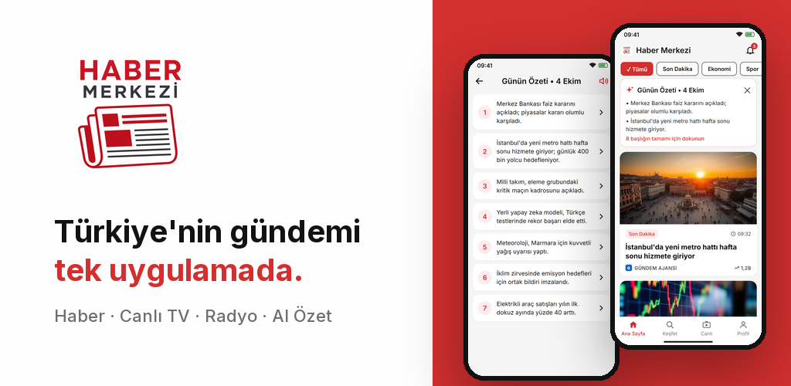
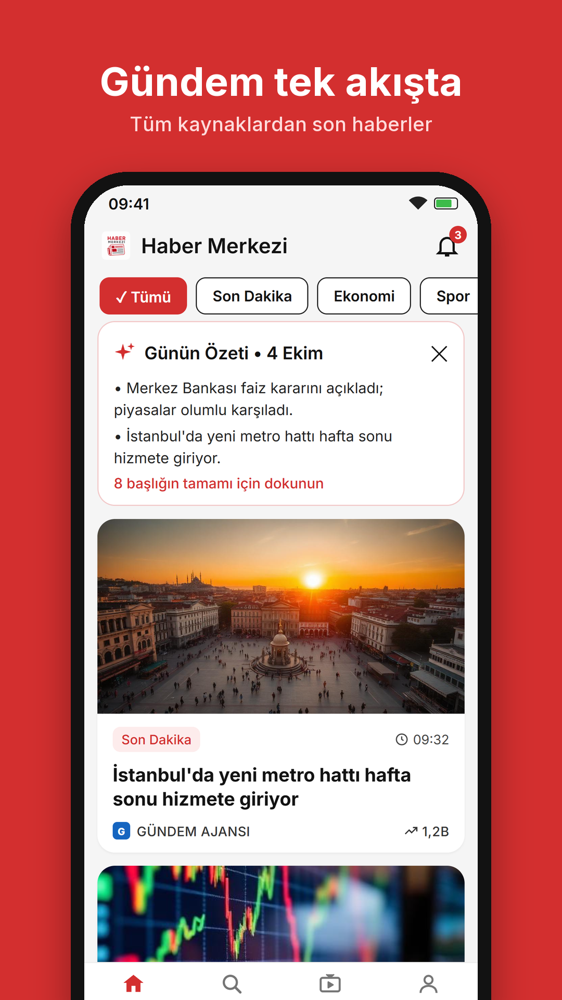
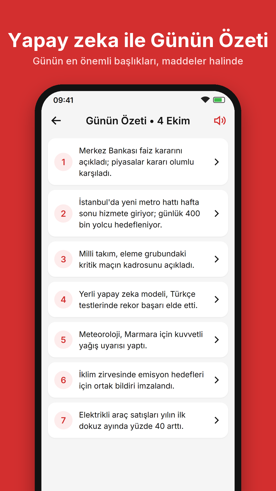
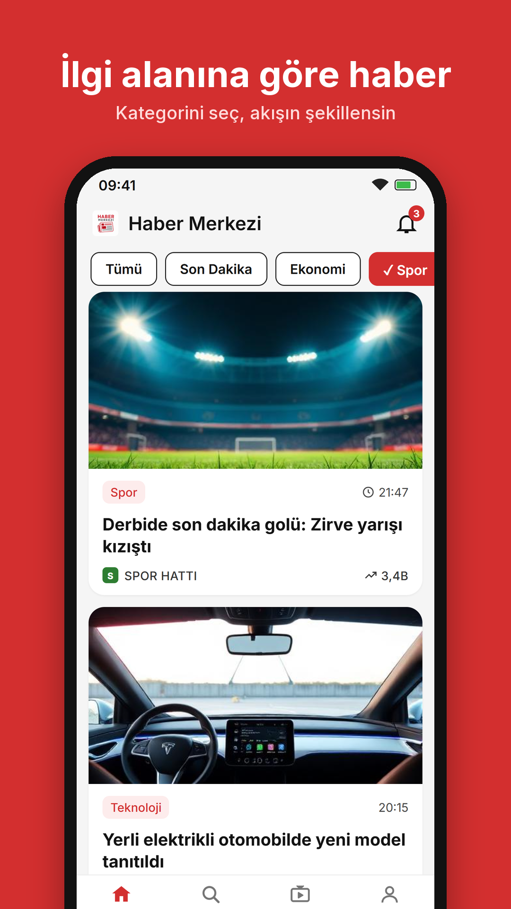
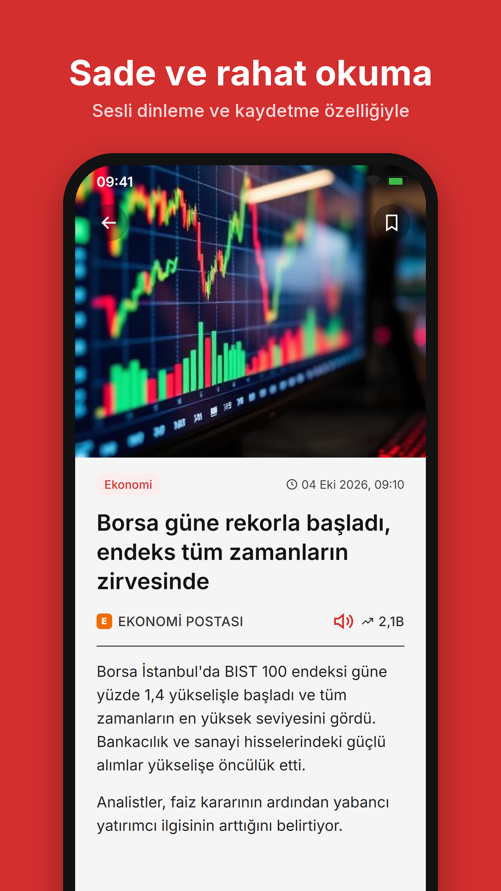
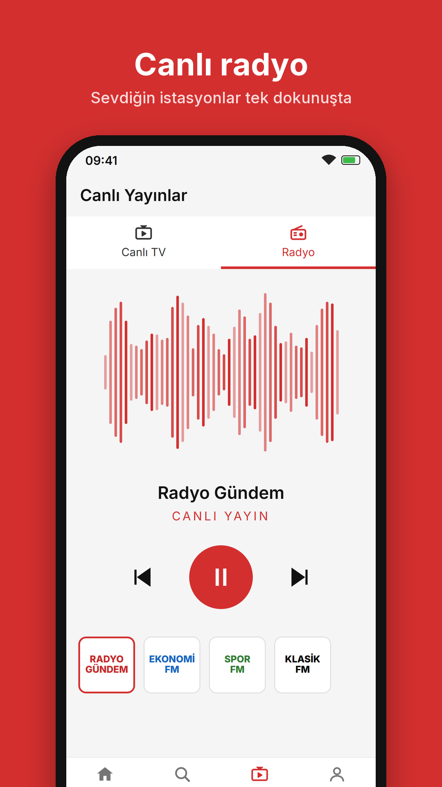
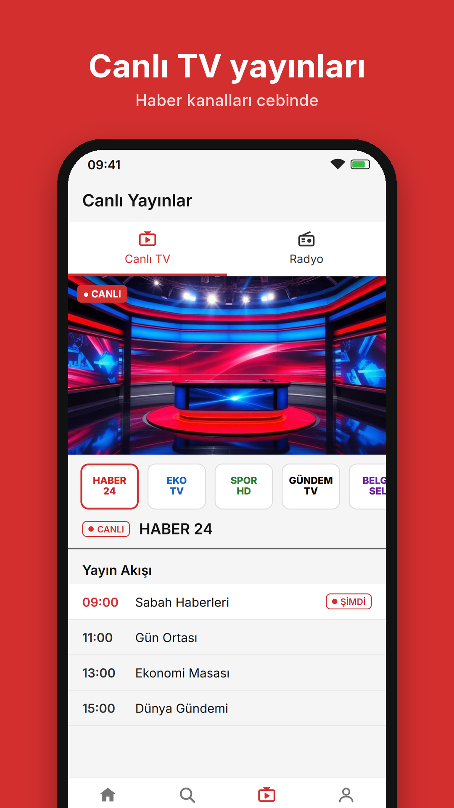
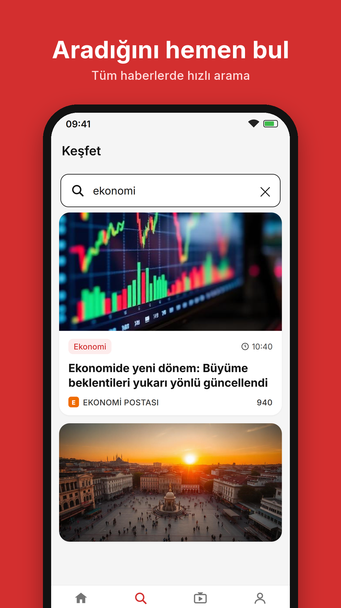
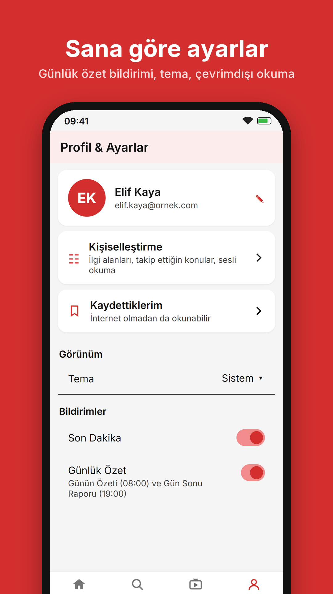

  

<h1 align="center">Haber Merkezi</h1>

  <b>Türkiye'nin gündemi, canlı TV ve radyo tek uygulamada.</b> 
  Günün özeti, sesli dinleme ve konu takibiyle haberi daha hızlı takip edin.

  

> **Durum:** Google Play'de kapalı test aşamasında. Herkese açık sürüm yakında.

## Ekran görüntüleri

  
  
  
  

  
  
  
  

## Öne çıkanlar

- **Son dakika ve kategori haberleri:** Her haberde kaynak adı ve orijinal habere bağlantı.
- **Günün Özeti (08:00) ve Gün Sonu Raporu (19:00):** Günün en önemli gelişmeleri yapay zekâ ile kısa maddeler hâlinde.
- **Canlı TV ve radyo:** Radyo arka planda ve ekran kapalıyken de çalar.
- **Kişiselleştirme:** Kategori sekmelerini sıralayın, istemediklerinizi gizleyin.
- **Anlık bildirimler:** Önemli gelişmelerden haberdar olun.
- **Kaydet:** Haberleri daha sonra okumak için kaydedin.
- **Sadece Wi-Fi ile oynat:** Mobil veri kotanızı koruyun.
- **Koyu tema desteği.**

## Premium

- **Konu takibi:** Takip ettiğiniz kelime başlıkta geçtiğinde anında bildirim.
- **Kategori özetleri:** Her kategorinin günlük kısa özeti.
- **Sesli dinleme:** Özetleri ve haberleri sesli dinleyin.
- **Yapay zekâ özeti:** Uzun haberler için kısa özet.
- **Sınırsız kaydetme** ve internet olmadan okuma.
- **Reklamsız kullanım.**

## Gizlilik

Verileriniz satılmaz ve reklam amacıyla üçüncü kişilerle paylaşılmaz. Yapay zekâya yalnızca haber metinleri gönderilir, kişisel veriniz gönderilmez.

- [Gizlilik Politikası](https://legal.dogansoft.com.tr/habermerkezi-gizlilik)
- [Kullanım Koşulları](https://legal.dogansoft.com.tr/habermerkezi-kullanim-kosullari)
- [Hesap ve Veri Silme](https://legal.dogansoft.com.tr/habermerkezi-hesap-silme)

## İletişim

**DoğanSoft**

- E-posta: [info@dogansoft.com.tr](mailto:info@dogansoft.com.tr)
- Telefon: 0850 255 01 40
- Web: [dogansoft.com.tr](https://dogansoft.com.tr)

---

Haber içerikleri ilgili haber kaynaklarına aittir. Bu depo yalnızca tanıtım amaçlıdır; uygulamanın kaynak kodu burada yayınlanmaz. 
© 2026 DoğanSoft. Tüm hakları saklıdır.
